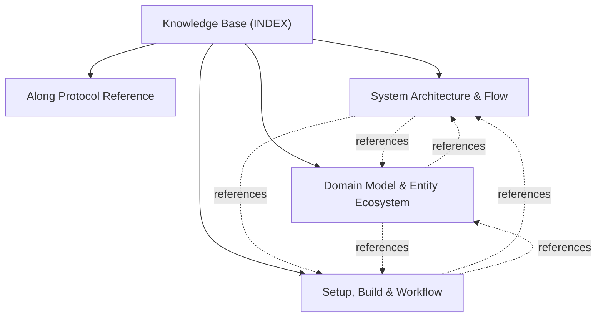

# @actdim/livestruct-demo - Knowledge Base Topic Index

Central entry point and cross-linked topic catalog for project documentation:

## Knowledge Graph & Topic Map

---

## Articles

- **[Along Protocol Reference](./topic--along-protocol.md)** (reference) `protocol`, `agents-md`, `checklist`, `routing`, `concurrency`, `along-team`, `conventions`
- **[System Architecture & Flow](./topic--architecture.md)** (architecture) `architecture`, `livestruct`, `msgmesh`, `opfs`, `worker`, `shared-worker`, `multi-tab`, `undo-redo`
- **[Domain Model & Entity Ecosystem](./topic--domain-model.md)** (domain-model) `domain-model`, `cad`, `shapes`, `livestore`, `schema`, `msgmesh`, `telemetry`
- **[Setup, Build & Workflow](./topic--setup-and-workflow.md)** (setup-workflow) `setup`, `workflow`, `vite`, `vitest`, `opfs`, `github-pages`, `ci`, `monorepo`

---

## Related Context

- [AGENTS.md](../AGENTS.md): Active protocol conventions and rules.
- [Decisions (ADRs)](./decisions/INDEX.md): Architectural Decision Records.
- [Domain Model & Entity Ecosystem](./topic--domain-model.md): Specifications for active issues and project history.
