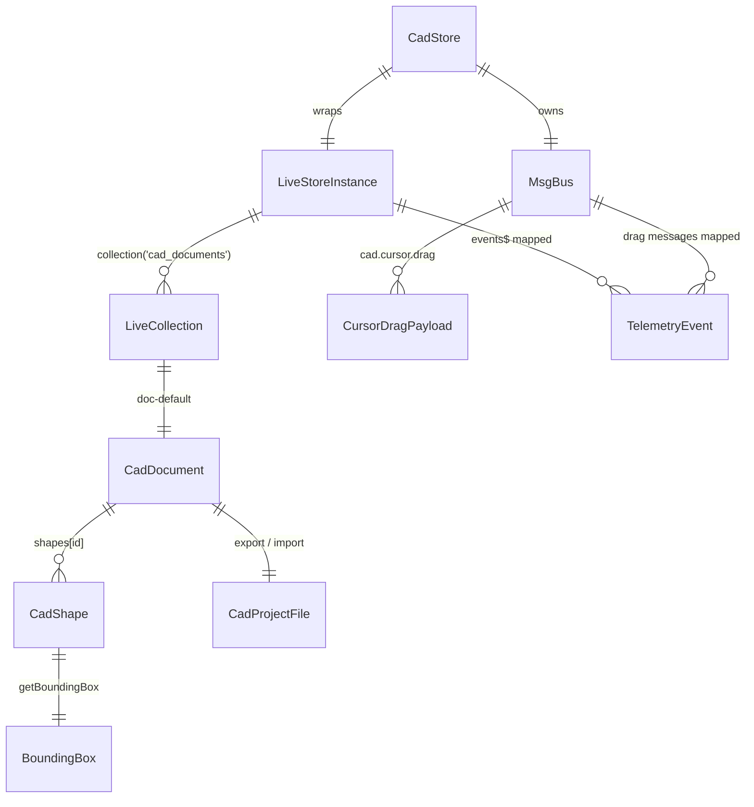

# @actdim/livestruct-demo Domain Model

## 1. Entity Taxonomy

| Entity | Defined in | Description |
|---|---|---|
| `CadShape` | `src/cad/types.ts` | One drawing primitive: `rect`, `circle` or `line`. |
| `CadDocument` | `src/cad/types.ts` | The edited document: title, selection and a map of shapes. Stored as a LiveStruct document. |
| `CadStore` | `src/cad/store.ts` | Per-context facade: LiveStruct store, `cad_documents` collection, `doc-default` document, msgmesh bus, counters, undo/redo stacks. |
| `CursorDragPayload` | `src/cad/types.ts` | Message payload of the bus channel `cad.cursor.drag`. |
| `TelemetryEvent` | `src/telemetry/types.ts` | One row of the protocol monitor. |
| `TelemetryMetrics` | `src/telemetry/types.ts` | Aggregates shown in the monitor's metrics bar. |
| `.cad` project file | `src/cad/exportImport.ts` | Portable SQLite 3 file with one `cad_documents` row. |
| `docs` row (spike) | `src/livestore/schema.ts` | Raw LiveStore table used only by the `?spike=livestore` harness. |
| `BoundingBox`, `TransformHandle` | `src/cad/types.ts` | Derived geometry for hit testing and selection rendering (`src/cad/geometry.ts`). |

## 2. Front-matter Schemas

The demo has no Markdown entities of its own; its "records" are TypeScript and storage schemas.

### 2.1. CAD shape

```typescript
export type CadShapeType = 'rect' | 'circle' | 'line';

export interface CadShape {
    id: string;
    type: CadShapeType;
    x: number;
    y: number;
    width?: number;   // rect
    height?: number;  // rect
    radius?: number;  // circle
    x2?: number;      // line end
    y2?: number;      // line end
    name?: string;
    layer?: string;   // inspector default: 'geometry'
    fill?: string;
    stroke?: string;
    strokeWidth?: number;
    rotation?: number;
}
```

### 2.2. CAD document

```typescript
export interface CadDocument {
    id: string;
    title: string;
    selectedShapeId?: string | null;
    shapes: Record<string, CadShape>;
    activeLayer?: string;
    metadata?: Record<string, unknown>;
}
```

`initCadStore` creates the document once per store if it is missing:

| Field | Seed value |
|---|---|
| collection | `cad_documents` |
| document id | `doc-default` |
| `title` | `Mechanical Assembly` |
| `selectedShapeId` | `rect-1` |
| `shapes` | `DEFAULT_SHAPES` or `options.initialShapes` |

`DEFAULT_SHAPES`:

| id | type | name | geometry |
|---|---|---|---|
| `rect-1` | `rect` | Main Bracket | x 60, y 60, 140 x 90 |
| `circle-1` | `circle` | Bearing Mount | x 320, y 120, radius 45 |
| `line-1` | `line` | Center Axis | (60, 240) -> (360, 240) |

All mutations are partial deep patches of `CadDocument`; a shape key set to `null` removes that shape (used by undo/redo and import).

### 2.3. Bus channels and payloads

The bus is `createMsgBus<CadMsgStruct>()` from `@actdim/msgmesh/core` (or `options.bus`).

```typescript
export interface CursorDragPayload {
    shapeId: string;
    x: number;
    y: number;
    dx: number;
    dy: number;
    timestamp: number;
    senderId?: string;
}

export type CadMsgStruct = {
    'cad.cursor.drag': { in: CursorDragPayload };
};

export const CAD_DRAG_CHANNEL = 'cad.cursor.drag' as const;
```

`TelemetryMonitor` listens on `CAD_DRAG_CHANNEL` with an abort signal and records each message as an `ephemeral` event, computing latency from `payload.timestamp`. Channel semantics (groups, request/response) are described on the msgmesh and msgmesh-store sites ([https://actdim.github.io/msgmesh-store/](https://actdim.github.io/msgmesh-store/)).

### 2.4. LiveStore schema usage

- **CAD app**: `src/livestore/worker.ts` runs `makeWorker({ schema })` with the schema from `@actdim/livestruct/engine`. The demo does not define tables for the CAD document; it uses the LiveStruct collection API (`liveStore.collection<CadDocument>('cad_documents')`, `collection.get`, `collection.create`, `doc.patch`, `doc.flush`, `doc.$`, `doc.isTentative`). Storage layout is described at [https://actdim.github.io/livestruct/](https://actdim.github.io/livestruct/).
- **Spike harness**: `src/livestore/schema.ts` defines a standalone LiveStore schema used with `makePersistedAdapter` and `storeId: 'spike-livestore-cad'`:

| Element | Definition |
|---|---|
| table `docs` | `id` text primary key, `body` text JSON (default `{}`), `mutation_id` text, `origin` text |
| event `doc.created` | `{ id, body, mutationId, origin }` -> insert row |
| event `doc.patched` | `{ id, patch, mutationId, origin }` -> `UPDATE docs SET body = json_patch(body, ?) ...` |
| event `doc.deleted` | `{ id, mutationId, origin }` -> delete row |

### 2.5. `.cad` project file

```sql
CREATE TABLE cad_documents (id TEXT PRIMARY KEY, title TEXT, data TEXT)
```

One row: `id` = document id (default `doc-default`), `title`, `data` = `JSON.stringify(CadDocument)`. Import also accepts `{ "documents": { "cad_documents:doc-default": { "data": CadDocument } } }` and a bare `CadDocument` JSON object.

### 2.6. Telemetry messages

```typescript
export type TelemetryCategory = 'ephemeral' | 'sqlite' | 'cdc';

export interface TelemetryEvent {
    id: string;
    timestamp: number;
    category: TelemetryCategory;
    channel: string;
    latencyUs?: number;
    sizeBytes?: number;
    updatedFields?: string[];
    rev?: number;
    origin?: string;
    payloadSummary: string;
    rawPayload?: unknown;
}
```

Mapping from sources to monitor rows:

| Source | Channel | Category | Badge |
|---|---|---|---|
| LiveStruct `local_patch` | `livestruct.patch` | `ephemeral` | RAM |
| LiveStruct `overlay_sent` | `livestruct.overlay.sent` | `ephemeral` | RAM |
| LiveStruct `overlay_received` | `livestruct.overlay.received` | `cdc` | CDC |
| LiveStruct `commit` | `sqlite.commit` | `sqlite` | SQLITE COMMIT (with `rev`, size, fields) |
| LiveStruct `remote_commit` | `cdc.replica` | `cdc` | CDC REPLICA (with origin) |
| Bus `cad.cursor.drag` | `cad.cursor.drag` | `ephemeral` | RAM |
| "Simulate CDC" button | `cdc.replica` (origin `tab-2`) | `cdc` | CDC REPLICA |

`updatedFields` are leaf dot paths from `extractUpdatedFields(patch)` (for example `shapes.rect-1.x`); `sizeBytes` is the UTF-8 JSON size from `calculatePayloadSize`. `TelemetryMetrics` holds `messagesPerSec` (rolling 1 s window from `calculateThroughput`), `diskWriteCount` (from `CadStore.diskCommitCount` when a store exists), and per-category totals. Filters accept `ALL`, `cad.*`, `sqlite.*`, `cdc.*` or free text matched against channel, category, payload summary, origin and fields.

## 3. Graph Relationships



- `CadDocument.selectedShapeId` references a key of `CadDocument.shapes` or is `null`.
- Each browsing context owns one `CadStore`; all contexts of one origin share the persisted `cad_documents/doc-default` through LiveStore.
- Undo/redo stacks hold whole `CadDocument` snapshots and are not persisted.

## 4. Cross-Links

- [Architecture](./topic--architecture.md): data flow, worker topology, invariants.
- [Setup & Workflow](./topic--setup-and-workflow.md): commands and tests that exercise these models.
