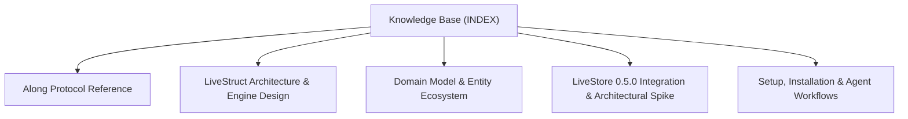

# @actdim/livestruct - Knowledge Base Topic Index

Central entry point and cross-linked topic catalog for project documentation:

## Knowledge Graph & Topic Map

---

## Articles

- **[Along Protocol Reference](./topic--along-protocol.md)** (reference) `protocol`, `agents-md`, `checklist`, `routing`, `concurrency`, `along-team`, `conventions`
- **[LiveStruct Architecture & Engine Design](./topic--architecture.md)** (architecture) `architecture`, `livestore`, `opfs`, `worker`, `schema`, `blobs`
- **[Domain Model & Entity Ecosystem](./topic--domain-model.md)** (domain-model) `domain-model`, `entities`, `schemas`, `dag`, `metadata`
- **[LiveStore 0.5.0 Integration & Architectural Spike](./topic--livestore-integration.md)** (topic) `livestore-integration`
- **[Setup, Installation & Agent Workflows](./topic--setup-and-workflow.md)** (setup-workflow) `setup`, `workflow`, `installation`, `lifecycle`, `quality-gates`

---

## Related Context

- [AGENTS.md](../AGENTS.md): Active protocol conventions and rules.
- [Decisions (ADRs)](./decisions/INDEX.md): Architectural Decision Records.
- [Domain Model & Entity Ecosystem](./topic--domain-model.md): Specifications for active issues and project history.
