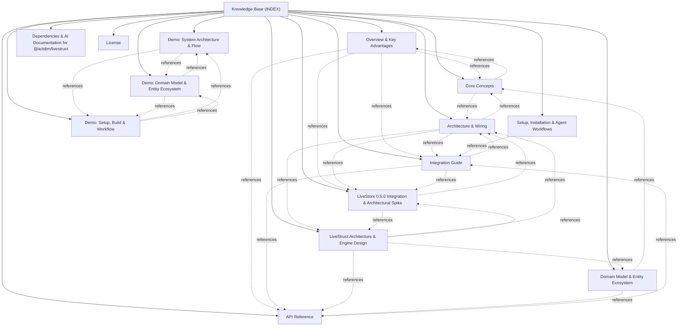

# @actdim/livestruct - Knowledge Base Topic Index

Central entry point and cross-linked topic catalog for project documentation:

## Knowledge Graph & Topic Map

---

## Articles

- **[Overview & Key Advantages](./topic--01-overview-and-advantages.md)** (topic) `01-overview-and-advantages`, `overview`, `livestore`, `local-first`
- **[Core Concepts](./topic--02-core-concepts.md)** (topic) `02-core-concepts`, `document`, `collection`, `lens`, `cdc`, `overlays`
- **[Architecture & Wiring](./topic--03-architecture-and-wiring.md)** (topic) `03-architecture-and-wiring`, `topology`, `worker`, `shared-worker`, `data-flow`
- **[Integration Guide](./topic--04-integration-guide.md)** (topic) `04-integration-guide`, `setup`, `vite`, `worker`, `react`, `mobx`, `msgmesh`, `vitest`
- **[API Reference](./topic--05-api-reference.md)** (topic) `05-api-reference`, `api`, `contracts`, `exports`
- **[LiveStruct Architecture & Engine Design](./topic--architecture.md)** (architecture) `architecture`, `livestore`, `opfs`, `worker`, `schema`, `blobs`
- **[Demo: System Architecture & Flow](./topic--demo-architecture.md)** (topic) `architecture`, `livestruct`, `msgmesh`, `opfs`, `worker`, `shared-worker`, `multi-tab`, `undo-redo`
- **[Demo: Domain Model & Entity Ecosystem](./topic--demo-domain-model.md)** (topic) `domain-model`, `cad`, `shapes`, `livestore`, `schema`, `msgmesh`, `telemetry`
- **[Demo: Setup, Build & Workflow](./topic--demo-setup-and-workflow.md)** (topic) `setup`, `workflow`, `vite`, `vitest`, `opfs`, `github-pages`, `ci`, `monorepo`
- **[Dependencies & AI Documentation for @actdim/livestruct](./topic--dependencies.md)** (topic) `dependencies`, `subproject`, `ai-context`, `rules`
- **[Domain Model & Entity Ecosystem](./topic--domain-model.md)** (domain-model) `domain-model`, `entities`, `schemas`, `document`, `collection`, `cdc`, `events`
- **[License](./topic--license.md)** (license) `license`, `mit`
- **[LiveStore 0.5.0 Integration & Architectural Spike](./topic--livestore-integration.md)** (topic) `livestore-integration`
- **[Setup, Installation & Agent Workflows](./topic--setup-and-workflow.md)** (setup-workflow) `setup`, `workflow`, `installation`, `lifecycle`, `quality-gates`, `playwright`, `testing`

---

## Related Context

- [AGENTS.md](../AGENTS.md): Active protocol conventions and rules.
- [Decisions (ADRs)](./decisions/INDEX.md): Architectural Decision Records.
- [Domain Model & Entity Ecosystem](./topic--domain-model.md): Specifications for active issues and project history.
