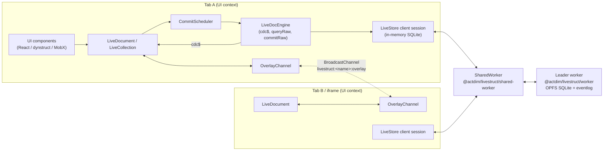
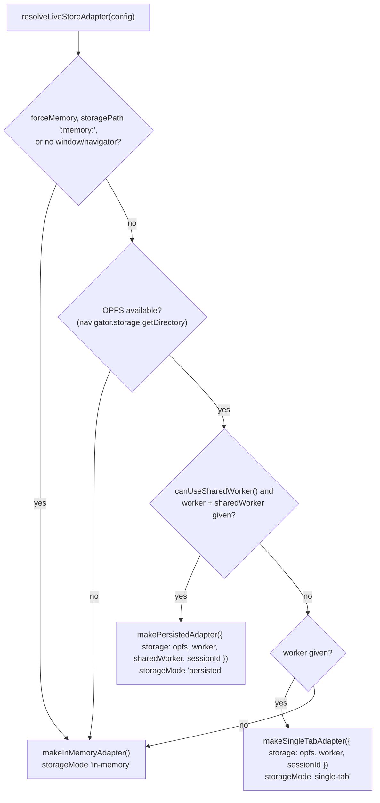
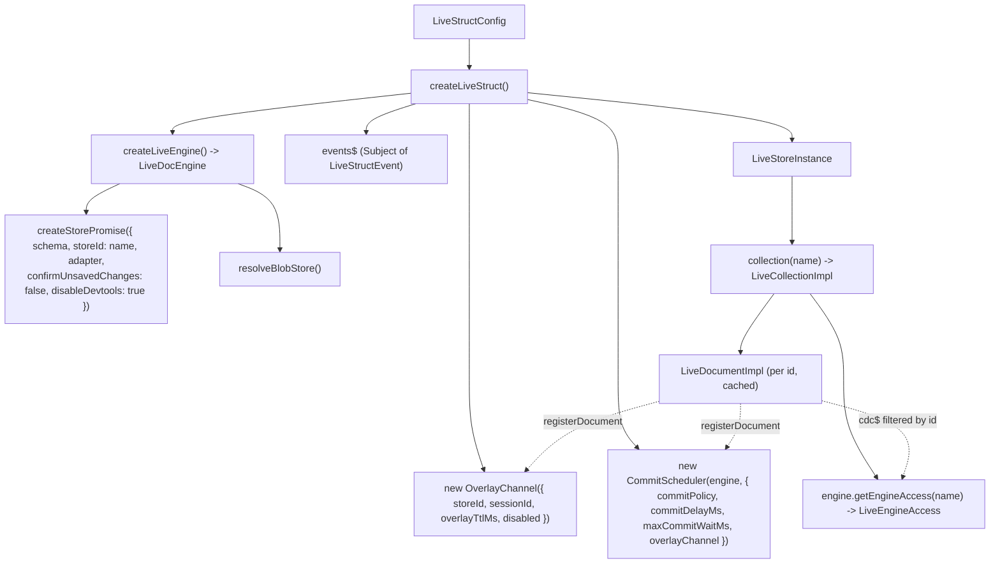
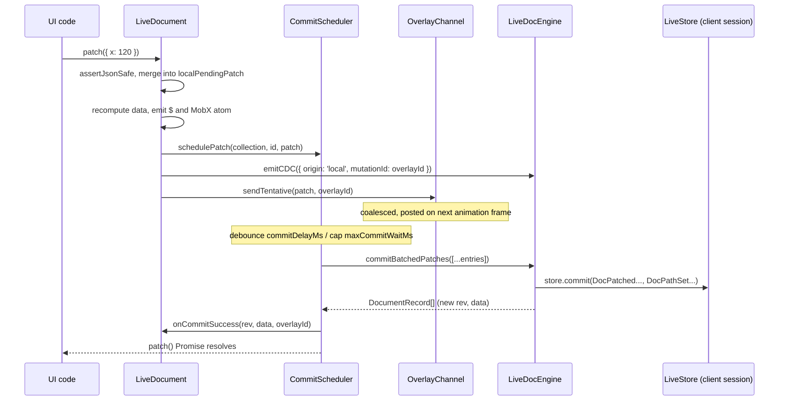
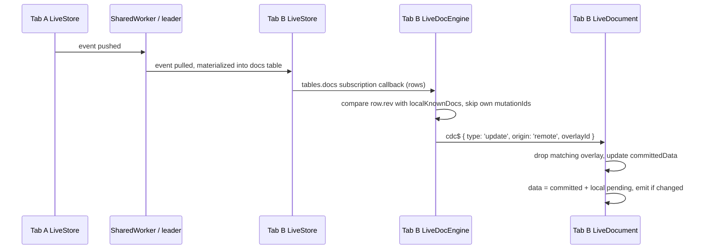
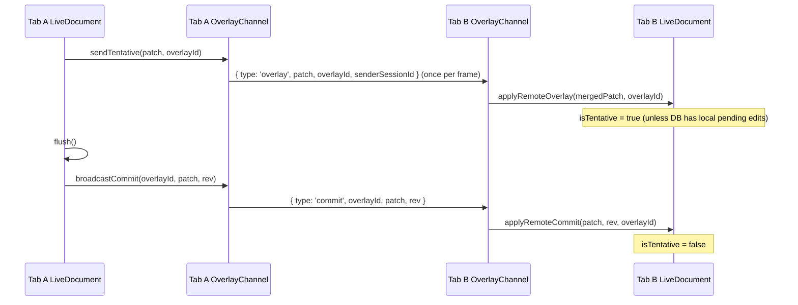
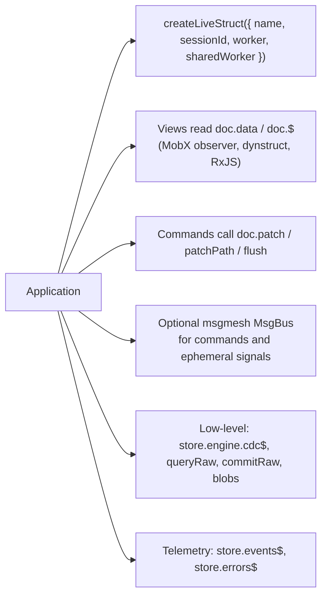

# Architecture & Wiring

[<- Back to 02. Core Concepts](./topic--02-core-concepts.md) | [Next: 04. Integration Guide ->](./topic--04-integration-guide.md)

---

This page describes how the pieces are wired at runtime and how data flows between them. Two companion pages go deeper:

- [LiveStruct Architecture & Engine Design](./topic--architecture.md) - the `docs` table, materializers, BlobStore, lazy-commit internals.
- [LiveStore 0.5.0 Integration & Architectural Spike](./topic--livestore-integration.md) - measured evidence behind the design (latency, bundle size, worker shipping, iframe sessions).

---

## 1. Runtime Topology

LiveStruct runs in up to three kinds of JavaScript contexts:

| Context | What runs there | Entry |
|---|---|---|
| **UI context** (each tab or same-origin iframe) | `createLiveStruct` store, collections, documents, `CommitScheduler`, `OverlayChannel`, `LiveDocEngine`, LiveStore client session with an in-memory SQLite mirror. | `@actdim/livestruct` |
| **Leader dedicated worker** (one per store, elected) | LiveStore leader: persistent SQLite on OPFS, eventlog, materializers from the built-in `schema`. | `@actdim/livestruct/worker` (`makeWorker({ schema })`) |
| **SharedWorker** (one per origin and store) | LiveStore shared worker: connects all client sessions to the leader. | `@actdim/livestruct/shared-worker` |

Two independent channels connect contexts:

1. **The durable path** - LiveStore events travel client session -> SharedWorker -> leader worker -> OPFS, and back out to every other client session. Each session's `docs` table subscription feeds `LiveDocEngine`, which emits remote CDC events.
2. **The ephemeral path** - `OverlayChannel` posts tentative patches and flush notifications over a `BroadcastChannel`. Nothing on this path is persisted.

### Adapter selection

`resolveLiveStoreAdapter(config)` picks the LiveStore adapter at startup; the result is visible as `store.storageMode`:

If adapter construction throws, the engine falls back to the in-memory adapter. The `BlobStore` follows the same decision: in-memory when `forceMemory` is set or the resolved mode is `in-memory`, otherwise `OpfsBlobStore` (`livestruct-blobs/` directory, with an in-memory fallback per operation).

---

## 2. Object Wiring Inside One Context

`createLiveStruct` builds a small object graph. One engine, one scheduler and one overlay channel are shared by every collection and document of the store:

Additional wiring done by `createLiveStruct`:

- `engine.cdc$` events with `origin: 'remote'` are re-emitted as `remote_commit` diagnostic events (deduplicated by collection, id, rev and overlay id).
- `window` `pagehide` and `document` `visibilitychange` (hidden) trigger `CommitScheduler.flushAll()`.
- `store.close()` removes those listeners, flushes, disposes the overlay channel, scheduler and collections, then closes the engine (which shuts down the LiveStore session).

---

## 3. Data Flow: Local Patch

Key properties:

- Nothing in the synchronous part of `patch()` touches SQLite; UI code sees the new `doc.data` immediately.
- The engine writes the merged patch as one `DocPatched` event (`json_patch(body, ?)`) and each path write as a `DocPathSet` event (`json_set(body, ?, json(?))`), all in a single `store.commit(...)` call per batch.
- Local CDC is emitted once, by the document, so the scheduler passes `emitCDC: false` to the engine.

## 4. Data Flow: Remote Change

Inserts are detected as rows with an unknown key, updates as rows with a higher `rev`, deletes as known keys missing from the row set. A remote delete disposes the cached document and removes it from its collection.

## 5. Data Flow: Tentative Overlay and Flush

Without an explicit flush, the overlay is cleared when the durable commit arrives through LiveStore (matched by overlay id) or when `overlayTtlMs` elapses.

---

## 6. Where the Application Plugs In

- **Views** stay declarative: MobX `observer` components (and dynstruct views) re-render when `doc.data` changes.
- **Commands** call document methods and decide when durability matters (`await doc.flush()` at the end of a gesture).
- **Messaging** (`@actdim/msgmesh`) is optional and lives beside the store; LiveStruct does not depend on it. A bridge from `engine.cdc$` to bus channels is application (or `@actdim/msgmesh-store`) code.

Step-by-step setup is in the [Integration Guide](./topic--04-integration-guide.md).

---

[<- Back to 02. Core Concepts](./topic--02-core-concepts.md) | [Next: 04. Integration Guide ->](./topic--04-integration-guide.md)
