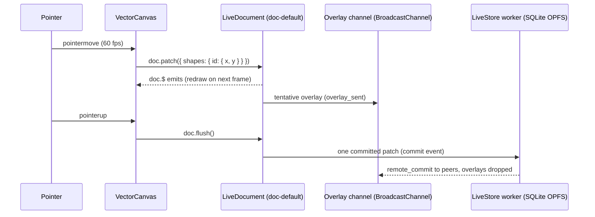
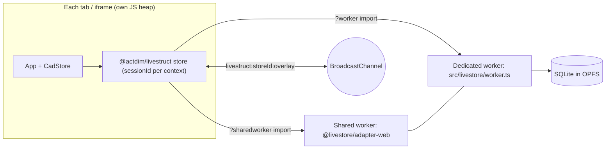
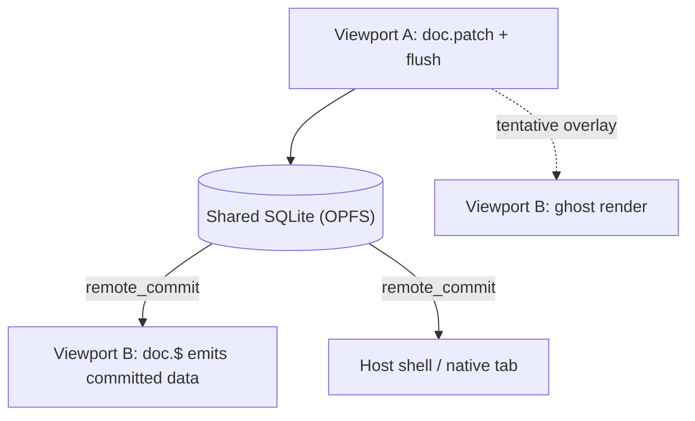

# @actdim/livestruct-demo Architecture

> The demo app lives in [`demo/`](../demo/README.md) of this repository; file paths in this article are relative to `demo/`.

## 1. System Overview

`@actdim/livestruct-demo` is a Vite + React 19 single-page app that showcases `@actdim/livestruct` living documents on top of LiveStore (SQLite in OPFS, run in a dedicated worker plus a shared worker) and a typed `@actdim/msgmesh` bus. One CAD document (`doc-default` in collection `cad_documents`) is edited from a 2D canvas and a property inspector; a telemetry monitor shows which changes stay in RAM and which reach SQLite.

The libraries themselves are documented on their own sites; this topic only covers how the demo wires them:

- livestruct: [https://actdim.github.io/livestruct/](https://actdim.github.io/livestruct/)
- msgmesh-store: [https://actdim.github.io/msgmesh-store/](https://actdim.github.io/msgmesh-store/)

```text
+-------------------------------------------------------------------------------+
|  App.tsx (query params: spike / viewport / split)                             |
+-------------------------------------------------------------------------------+
|  Zone 1: VectorCanvas        |  Zone 2: PropertyInspector (MobX observer)     |
|  pointer drag -> doc.patch   |  field edits -> CadStore.updateShapeProperties |
+-------------------------------------------------------------------------------+
|  SplitSimulator: single | dual iframe (?viewport=A/B) | native tab            |
|  undo/redo hotkeys, export (.cad download), import (file picker / drop)       |
+-------------------------------------------------------------------------------+
|  Zone 3: TelemetryMonitor: liveStore.events$ + bus channel cad.cursor.drag    |
+-------------------------------------------------------------------------------+
|  cad/store.ts  CadStore = LiveStoreInstance + LiveCollection + LiveDocument   |
|                + MsgBus<CadMsgStruct> + undo/redo snapshot stacks             |
+-------------------------------------------------------------------------------+
|  @actdim/livestruct  (commit scheduler, BroadcastChannel overlay channel)     |
|  LiveStore adapter-web: livestore/worker.ts + shared worker -> SQLite (OPFS)  |
+-------------------------------------------------------------------------------+
```

## 2. Core Components

| Component | File | Responsibility |
|---|---|---|
| `App` | `src/App.tsx` | Reads `spike`, `viewport`, `split` query params, creates one `CadStore` per browsing context, exposes it as `window.__cadStore`, renders the host shell or a child viewport. |
| `CadStore` / `initCadStore` | `src/cad/store.ts` | Creates the LiveStruct store (`name: 'cad_store'`, unique `sessionId` per context), the `cad_documents` collection and the `doc-default` document seeded with `DEFAULT_SHAPES`; counts `commit`, `overlay_sent`, `overlay_received`, `local_patch` events; keeps undo/redo stacks. |
| LiveStore worker | `src/livestore/worker.ts` | `makeWorker({ schema })` with the schema exported by `@actdim/livestruct/engine`; loaded through Vite's `?worker` import. |
| Shared worker | `@livestore/adapter-web/shared-worker?sharedworker` | Coordinates the OPFS leader across tabs and iframes of the same origin. |
| `VectorCanvas` | `src/components/VectorCanvas.tsx` | Canvas 2D rendering (`cad/renderer.ts`), hit testing and translation (`cad/geometry.ts`), redraw on `doc.$` via `requestAnimationFrame`, ghost rendering while `doc.isTentative`. |
| `PropertyInspector` | `src/components/PropertyInspector.tsx` | MobX `observer` form for the selected shape (name, layer, fill, stroke, stroke width, rotation, bounding box); the name input is buffered and debounced by 200 ms. |
| `SplitSimulator` | `src/components/SplitSimulator.tsx` | Viewport modes, Ctrl+Z / Ctrl+Y / Ctrl+Shift+Z hotkeys, export and import of `.cad` files. |
| `TelemetryMonitor` | `src/components/TelemetryMonitor.tsx` | Classifies events into `ephemeral`, `sqlite`, `cdc`; throughput, disk-write and per-category counters; channel filters; simulation buttons. |
| Telemetry helpers | `src/telemetry/types.ts` | `calculateThroughput`, `filterTelemetryEvents`, `extractUpdatedFields`, `calculatePayloadSize`. |
| Export / import | `src/cad/exportImport.ts` | Hand-built two-page SQLite 3 file (`cad_documents(id, title, data)`) and a parser that also accepts JSON payloads. |
| LiveStore spike | `src/components/LiveStoreSpikeHarness.tsx`, `src/livestore/schema.ts` | Raw LiveStore benchmark (`?spike=livestore`): host plus two iframes on `storeId: 'spike-livestore-cad'`, 100-commit latency run. |

### 2.1. Entry modes

| URL | Renders |
|---|---|
| `/` | Host shell: `SplitSimulator` in `single` mode plus `TelemetryMonitor`. |
| `/?split=dual` | Host shell starting in dual iframe mode. |
| `/?viewport=A`, `/?viewport=B` | Child viewport (canvas + inspector + undo/redo buttons) used inside the dual iframes. |
| `/?viewport=native` | Same child viewport opened in a real browser tab by the "native tab" mode. |
| `/?spike=livestore` | `LiveStoreSpikeHarness` instead of the CAD app. |

## 3. Data Flow

### 3.1. RAM streaming vs SQLite commits

A canvas drag never writes to SQLite per pointer event. `VectorCanvas` calls `store.doc.patch()` on every `pointermove`; livestruct applies the patch in memory, broadcasts it as a tentative overlay and coalesces it in its commit scheduler. `pointerup` calls `doc.flush()`, which commits the pending patch. The test suite pins this: 300 scripted moves at 8 ms intervals produce at most 4 commits.



Inspector edits, selection changes, undo/redo and import go through `CadStore` methods or helpers that call `doc.patch()` followed by `await doc.flush()`, so each is one commit.

The msgmesh bus (`createMsgBus<CadMsgStruct>()`) carries the typed channel `cad.cursor.drag`. The monitor subscribes to it and classifies its messages as RAM traffic; the canvas itself drives drags through `doc.patch`, so this channel is an integration point for code that publishes drag streams, not the drag path.

### 3.2. Worker and shared-worker topology



`initCadStore` imports both workers only in a browser and only when `forceMemory` is false. In Node (Vitest) `forceMemory` defaults to true and the store runs in memory; if the worker imports fail, `createLiveStruct` receives no workers.

### 3.3. Multi-tab sync

Every context (host, iframe A, iframe B, native tab) creates its own `CadStore` with a distinct `sessionId` (`session_<senderId>_<time>_<random>`) against the same store name. Peers receive tentative overlays first (the canvas renders ghost shapes and shows "Tentative Remote Overlay"), then the committed change, which livestruct reports as `remote_commit` and the monitor lists as `cdc.replica`. The dual iframes use `sandbox='allow-scripts allow-same-origin allow-forms'`, so they share the origin, OPFS and BroadcastChannel but no in-memory state.



### 3.4. Undo/redo

`CadStore` keeps per-context snapshot stacks. `commitShapeTransform` and `updateShapeProperties` push a deep copy of `doc.data` (stack capped at 50) and clear the redo stack; `selectShape` does not. `undo` / `redo` swap snapshots and call `applySnapshot`, which builds a patch that sets `title`, `selectedShapeId` and every shape of the target, and sets shapes missing from the target to `null`. Because the result is an ordinary committed patch, it replicates to other viewports like any edit; the stacks themselves stay local to the context that made the edits. Canvas drags patch the document directly and do not push undo snapshots.

### 3.5. Export and import

- **Export** (`exportCadDatabase`, `downloadCadProject`): serializes the current `doc.data` into a two-page SQLite 3 file built byte by byte (`CREATE TABLE cad_documents (id TEXT PRIMARY KEY, title TEXT, data TEXT)`, one row whose `data` column is the document JSON; 4096-byte pages, 65536 when the row does not fit). It is downloaded as `project.cad` with type `application/x-sqlite3`. It does not copy the LiveStore OPFS database file.
- **Import** (`parseCadDatabase`, `importCadDatabase`): accepts that SQLite layout (with a JSON scan fallback), a LiveStruct JSON export (`documents["cad_documents:doc-default"].data`) or a raw `CadDocument` JSON. The parsed document is applied as one replacing patch plus `flush`, so all peers update; unknown formats throw `Unsupported or corrupted CAD project format.`

## 4. Invariants

1. **One store per browsing context**: `App` creates and closes the `CadStore` in an effect keyed by `viewport`; disposal closes the LiveStruct store and the events subscription.
2. **Drags commit once**: pointer moves only `doc.patch`; `pointerup` flushes. No component writes SQLite per frame.
3. **Every inspector, undo/redo and import edit is a committed patch**: these paths end with `await doc.flush()`.
4. **Peers sync only through the store**: iframes and tabs exchange data via OPFS/LiveStore and the livestruct overlay channel, never through `postMessage` (the spike harness uses `postMessage` only for benchmark reporting).
5. **Node tests stay in memory**: `forceMemory` defaults to true outside a browser; no worker or OPFS is touched by Vitest.
6. **Library behaviour lives in the libraries**: commit timing, overlay TTL and echo handling are livestruct settings; the demo does not reimplement them.
7. **Deployment path is configurable**: `vite.config.ts` uses `base: process.env.DEMO_BASE || '/'`; links inside the app are relative (`?viewport=A`) so they work under `/livestruct/demo/`.

## 5. Cross-Links

- [Domain Model](./topic--demo-domain-model.md): shape and document model, channels, schemas, telemetry records.
- [Setup & Workflow](./topic--demo-setup-and-workflow.md): commands, tests, browser requirements, Pages CI.
- [README](../demo/README.md): scenarios and zone layout.
