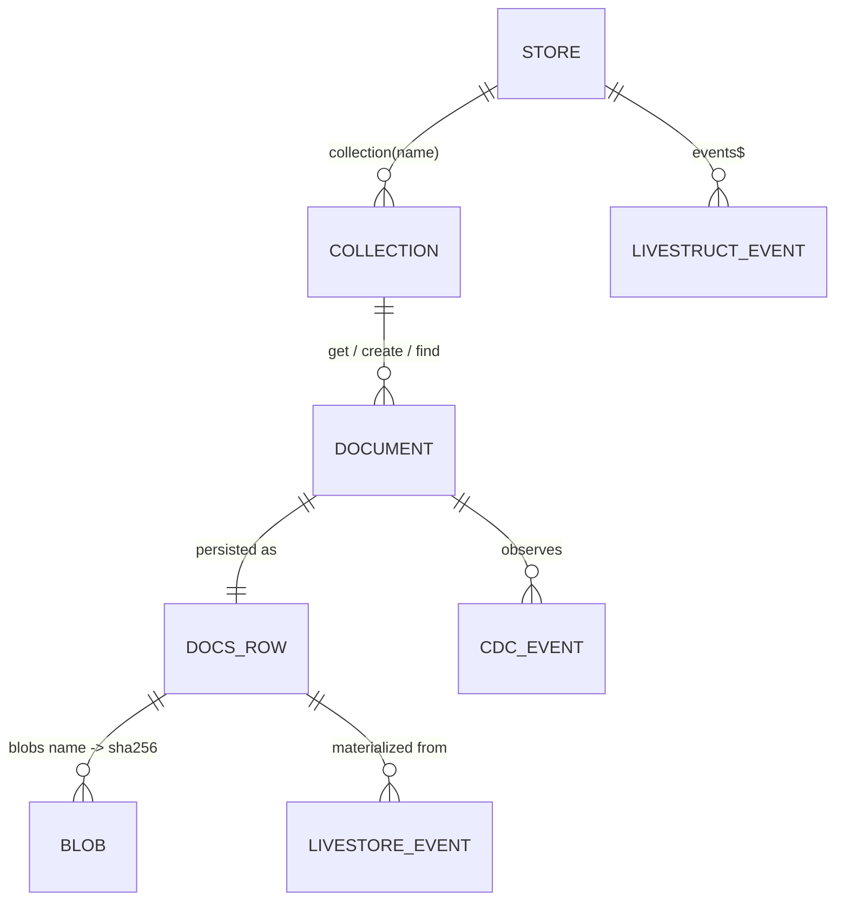
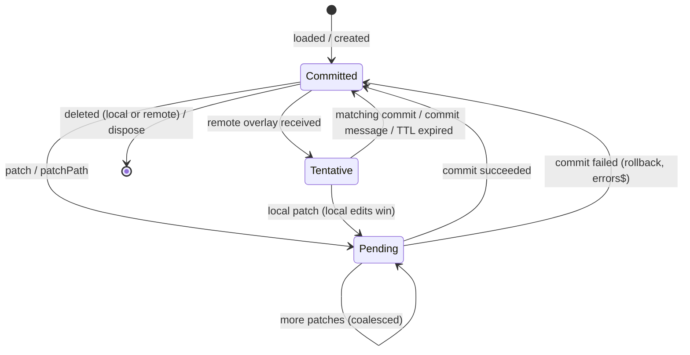

# Domain Model & Entity Ecosystem

Core technical specification of the entities, records and event contracts that `@actdim/livestruct` manages. For usage see [Core Concepts](./topic--02-core-concepts.md); for the full symbol list see [API Reference](./topic--05-api-reference.md).

## 1. Entity Overview

| Entity | Type | Identity | Lifetime |
|---|---|---|---|
| Store | `LiveStoreInstance` | `LiveStructConfig.name` (LiveStore `storeId`) + `sessionId` | `createLiveStruct()` until `close()` |
| Collection | `LiveCollection<T>` | collection name | cached per store until `dispose()` |
| Document | `LiveDocument<T>` | `(collection, id)` | cached per collection until deleted or disposed |
| Persisted row | `docs` table row / `DocumentRecord<T>` | `key = makeDocKey(collection, id)` | until `DocDeleted` |
| Blob | `Uint8Array` / `Float32Array` in a `BlobStore` | SHA-256 hex of tag byte + bytes | content-addressed, shared by identical payloads |

## 2. Persisted Record (`docs` table)

All collections share one table defined in `src/engine/schema.ts`:

| Column | Type | Meaning |
|---|---|---|
| `key` | TEXT, primary key | `` `${collection}\u0001${id}` `` |
| `collection` | TEXT | Collection name. |
| `id` | TEXT | Document id within the collection. |
| `body` | TEXT, default `'{}'` | JSON document body. |
| `rev` | INTEGER, default 1 | Revision; incremented by every replace, patch and path set. |
| `updatedAt` | INTEGER | Millisecond timestamp carried by the event. |
| `blobs` | TEXT, default `'{}'` | JSON map of blob name to SHA-256 hash. |
| `mutationId` | TEXT | Id of the last mutation (echo suppression). |
| `overlayId` | TEXT | Overlay id of the last mutation (tentative overlay matching). |
| `origin` | TEXT | `local`, `remote` or `migration`. |

Index: `idx_docs_collection_updatedAt (collection, updatedAt)`.

The in-memory projection of a row is `DocumentRecord<T>`: `{ collection, id, rev, data, blobs, updatedAt }`, where `blobs` is a `BlobMap` of rehydrated typed arrays (filled by `getDoc`, empty for `queryDocs`).

## 3. Events (Write Model)

LiveStore synced events (namespace `livestruct.v1.`), all carrying `collection`, `id`, `mutationId`, `origin`, `updatedAt`:

| Event | Extra fields | Materializer |
|---|---|---|
| `DocInserted` | `data`, `blobs?`, `overlayId?` | `INSERT ... rev = 1 ... ON CONFLICT (key) DO NOTHING` |
| `DocReplaced` | `data`, `blobs?`, `overlayId?` | upsert; on conflict replace `body`, `rev = rev + 1` |
| `DocPatched` | `patch`, `blobs?`, `overlayId?` | `body = json_patch(body, ?)`, `rev = rev + 1` |
| `DocPathSet` | `path`, `value`, `overlayId?` | `body = json_set(body, ?, json(?))`, `rev = rev + 1` |
| `DocDeleted` | - | `DELETE FROM docs WHERE key = ?` |

`data`, `patch`, `value` and `blobs` are JSON strings; binary payloads never appear in events (only hashes).

Application-level writes map to events as follows:

| API | Event(s) |
|---|---|
| `collection.create`, `engine.insertDoc`, `commitRaw({ type: 'insert' })` | `DocInserted` |
| `doc.replace`, `engine.updateDoc`, `commitRaw({ type: 'update' })` | `DocReplaced` |
| `doc.patch` (via scheduler), `engine.patchDoc`, `commitRaw({ type: 'patch' })` | `DocPatched` |
| `doc.patchPath` (via scheduler), `engine.setPathDoc` | `DocPathSet` |
| `collection.delete`, `engine.deleteDoc`, `commitRaw({ type: 'delete' })` | `DocDeleted` |
| legacy v1 migration | `DocInserted` with `origin: 'migration'` |

## 4. Document State Model

A `LiveDocument` combines three layers into the visible `data`:

| State | `isPending` | `isTentative` | `data` |
|---|---|---|---|
| Committed | `false` | `false` | committed body |
| Pending | `true` | `false` | committed body + local pending patches |
| Tentative | `false` | `true` | committed body + remote overlay patch |

## 5. Change Data Capture Contract

`CDCEvent<T>` (`src/engine/types.ts`):

| Field | Meaning |
|---|---|
| `type` | `insert`, `update` or `delete`. |
| `kind` | Adds `replace` for full-body replacement. |
| `collection`, `id` | Target document. |
| `rev` | Revision after the change. |
| `delta` | Patch (local patch) or full body (inserts, replaces, remote updates). |
| `data` | Full body after the change (absent for deletes). |
| `timestamp` | Milliseconds. |
| `mutationId`, `overlayId` | Correlation ids for echo suppression and overlay matching. |
| `origin` | `local`, `remote` or `migration`. |

`LiveEngineAccess<T>.cdc$` (the per-collection view used by `doc.engine`) carries `type`, `id`, `delta`, and `mutationId` / `overlayId` when present.

## 6. Diagnostic Events

`LiveStructEvent` (`src/document/types.ts`): `type` (`local_patch`, `overlay_sent`, `overlay_received`, `commit`, `remote_commit`), `collection`, `id`, `timestamp`, optional `rev`, `overlayId`, `senderSessionId`, `origin`, `patch`.

## 7. Ephemeral Messages

`OverlayChannel` messages on `BroadcastChannel` `livestruct:<storeId>:overlay`:

- `OverlayMessage` - `{ type: 'overlay', collection, id, patch, overlayId, senderSessionId, timestamp }`.
- `CommitMessage` - `{ type: 'commit', collection, id, overlayId, patch?, rev?, senderSessionId, timestamp }`.

They are never persisted.

## 8. Value Constraints

Document bodies must be JSON-safe (`assertJsonSafe`): no `NaN` / `Infinity`, functions, symbols, bigints, `Date`, `Map`, `Set`, typed arrays, `ArrayBuffer`, class instances or circular references. Violations throw `LiveStructValueError` with the offending `path`.
